# Kickstarter Crowdfunding Recommendation Engine

Built for a **State Street** challenge in the **Break Through Tech AI Studio (Fall 2026)** program. The project predicts whether a Kickstarter campaign will succeed or fail using information available at launch, explains which factors drive those predictions, and will prototype recommendations for campaigns at risk of failing.

📋 **Project board:** [paste your GitHub Project link here]

---

## 👩🏻‍💻 Author

| Name | GitHub Handle | Contribution |
|------|---------------|--------------|
| Michelle Lin | [@michelllinstar](https://github.com/michelllinstar) | Individual project: all milestones (data preparation, EDA, modeling, recommendation prototype) |

> This project started as a team project and became an individual project.

---

## 🎯 Project Highlights

- Built a reproducible pipeline that turns **45,957 raw campaigns** into **38,492 U.S. campaigns** with a final success/fail outcome.
- Cleaned inconsistent category labels (e.g. `Film &amp; Video` vs. `Film & Video`) and quarantined **data-leakage** columns (pledged, funded percentage, backers, comments, updates).
- Recovered the **launch date** (deadline − duration) and engineered reward-tier statistics, pacing ratios, and launch-timing features, giving a **32-column model-ready matrix**.
- EDA found **goal size** is the dominant launch-time predictor (ρ = −0.26), followed by reward-tier *count* and duration. Category spans a 44-point success range; state spans only 28.

---

## 👩🏽‍💻 Setup and Installation

**1. Clone the repository**
```bash
git clone https://github.com/michelllinstar/StateStreet_BTT_individual.git
cd StateStreet_BTT_individual
```

**2. Create a virtual environment**

⚠️ **Python 3.11 or newer is required.** On older interpreters (3.8/3.9, which ship with macOS and
are often first on `PATH`) `pip` finds no prebuilt wheels for current pandas and falls back to
compiling from source, which hangs for a long time and then fails. Check before creating the
environment:

```bash
python3 --version        # must be 3.11+; if not, point explicitly at a newer one
python3.13 -m venv .venv && source .venv/bin/activate
# Windows PowerShell
py -3.13 -m venv .venv; .venv\Scripts\Activate.ps1
```

**3. Install dependencies**
```bash
pip install -r requirements.txt
python -m ipykernel install --user --name kickstarter   # register the kernel for Jupyter
```

**4. Get the data**
Download the Kickstarter Projects dataset from Kaggle and save it as:
```
data/DSI_kickstarterscrape_dataset.csv
```
The file is 12.9 MB and git-ignored, so it is not in the repository.

**5. Run the notebook** (Jupyter or VS Code — select the `kickstarter` kernel)

| Notebook | Tasks | What it does |
|----------|-------|--------------|
| `notebooks/kickstarter_data_prep_and_eda.ipynb` | 1–5 | Ingestion & US filtering, cleaning & missing values, feature engineering, encoding & scaling, and the full six-task EDA (goal/duration, category/subcategory, location, rewards & updates, interactions & significance tests, feature-selection write-up). Self-contained — runs top to bottom with no other project files. |
| `notebooks/milestone3_modeling.ipynb` | Modeling | *Coming next* |
| `notebooks/milestone4_recommendations.ipynb` | Recommendation prototype | *Planned* |

Running it end to end writes:

| Output | Contents |
|---|---|
| `data/processed/kickstarter_us_clean.csv` | 38,492 × 30 — cleaned, unscaled, real units. Use for EDA and for reading rows by eye. |
| `data/processed/train_encoded.csv` | 30,793 × 33 — encoded and scaled, plus the `success` label. |
| `data/processed/test_encoded.csv` | 7,699 × 33 — same transform, fitted on train only. |
| `figures/*.png` | 14 EDA charts. |

---

## 📁 Repository structure

```
.
├── data/
│   ├── DSI_kickstarterscrape_dataset.csv   # raw Kaggle file (git-ignored, download yourself)
│   └── processed/                          # written by the notebook (git-ignored)
├── figures/                                # EDA charts, committed
├── notebooks/
│   └── kickstarter_data_prep_and_eda.ipynb # Tasks 1–5, end to end
├── requirements.txt
└── README.md
```

All logic lives in the notebook; there is no separate `scripts/` package to keep in sync with it.

---

## 🏗️ Project Overview

Crowdfunding creators often set goals and campaign lengths without knowing what tends to work. This project uses past Kickstarter data to (1) predict whether a campaign will succeed and (2) turn the patterns behind successful campaigns into practical advice, such as setting a more realistic goal or a shorter campaign.

**ML problem type:** supervised binary classification (1 = successful, 0 = failed).
**Baseline to beat:** 54.7% — always predicting "successful". Classes are near-balanced, so accuracy
is a meaningful headline metric, reported alongside precision, recall, F1 and ROC-AUC.
**Target:** ~80% accuracy, carried over from the original team project's Random Forest
(≈80.2% accuracy, F1 ≈ 0.834). That figure was produced **before** the leakage columns were
identified, so it is treated as a loose reference rather than a goal to match — a clean
launch-time-only model should be expected to score lower, and that is the correct outcome.

---

## 📊 Data Exploration

**Dataset:** Kickstarter Projects (Kaggle), 45,957 rows × 17 columns (CSV).
**Coverage:** campaigns launched 2009-04-21 → 2012-05-29 (deadlines through 2012-06-03). This is
early-platform Kickstarter, so conclusions do not automatically transfer to the platform today.

### Data preparation log

| Step | Rows after |
|------|-----------|
| Raw data | 45,957 |
| Keep `successful` / `failed` (drop live, canceled, suspended) | 41,965 |
| Fix HTML codes in labels (14 → 13 categories) | 41,965 |
| Keep U.S. campaigns (valid 2-letter state), split location into city and state | 38,533 |
| Drop rows missing essential fields | **38,492** |

**Leakage quarantined:** `pledged`, `funded percentage`, `backers`, `comments`, and `updates` are only
observable after a campaign runs. `funded date` is the deadline — it is kept just long enough to
recover the launch date, then dropped.

**Encoding:** one-hot for `category` (13 levels); cross-fitted target encoding for `subcategory`
(49) and `state` (51); `city` dropped (3,155 values, captured by `state`).
**Scaling:** `StandardScaler` on all numerics, with `log1p` applied first to the skewed money
columns. Encoders and scalers are fitted on the **training split only**.

**Engineered features:** `duration_days` and launch calendar position (recovered from
deadline − duration), reward-tier statistics (`min`/`max`/`mean`/`median`/`spread`, `n_reward_tiers`),
and pacing ratios (`goal_per_day`, `backers_needed_at_mean_reward`, `reward_min_to_goal`), plus an
`is_default_30d` flag.

### Key EDA findings
Overall success rate: **54.7%** (classes are fairly balanced).

| Factor | Finding | Spearman ρ |
|--------|---------|-----------|
| Goal | 69.0% under $1k → 13.0% above $50k, monotonic across every band | −0.26 |
| Reward tiers (count) | 36.1% at 1–3 tiers → 68.9% at 13+ | +0.15 |
| Duration | 67.8% under 15 days → 41.6% past 60 days | −0.13 |
| Category | Dance 76.1%, Theater 70.5%, Music 67.8% / Fashion 32.5%, Technology 38.3% | — |
| State | 37.0% (FL) → 65.2% (NY) among states with 200+ campaigns; CA + NY = 38% of all | — |
| Reward *prices* | Near-flat — `reward_min`/`mean`/`max`/`spread` all \|ρ\| ≤ 0.03 | ~0 |
| Launch timing | Near-flat — year moves only 56.5% (2009) → 53.3% (2012) | ~0 |
| Subcategory | Widest categorical spread: 28.3% → 76.1% across 49 levels, all 119+ campaigns | — |
| Updates (leakage) | 20.3% at zero updates → 93.4% past 20 — excluded from the model | — |

### Charts

All fourteen figures are regenerated by the notebook into `figures/`.

**Goal — distribution, split by outcome, and success rate by band**
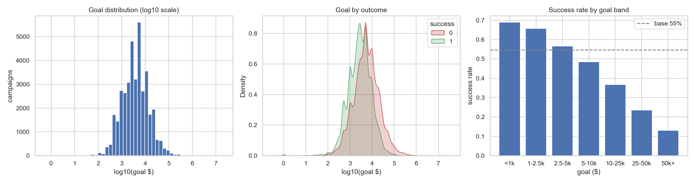

**Duration — distribution, split by outcome, and success rate by band**
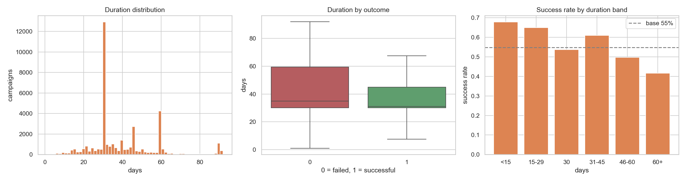

**Reward tiers — count, cheapest tier, and average tier price by outcome**
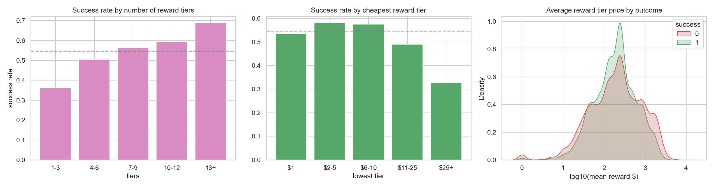

**Success rate by category**
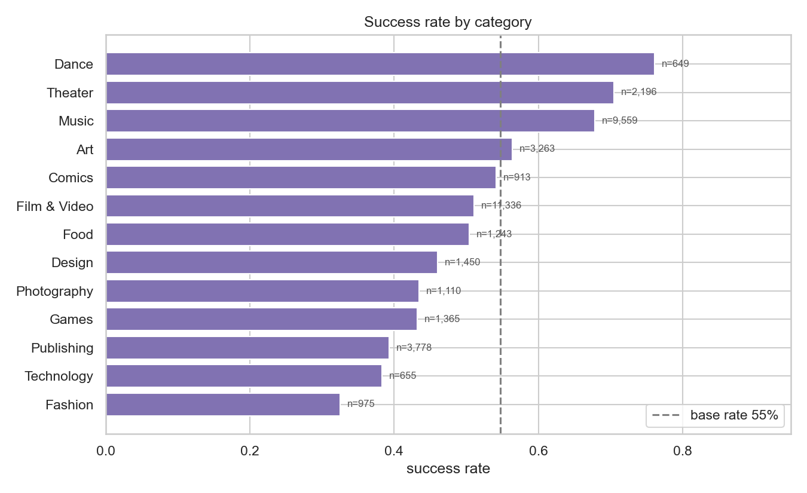

**Success rate by state** (200+ campaigns)
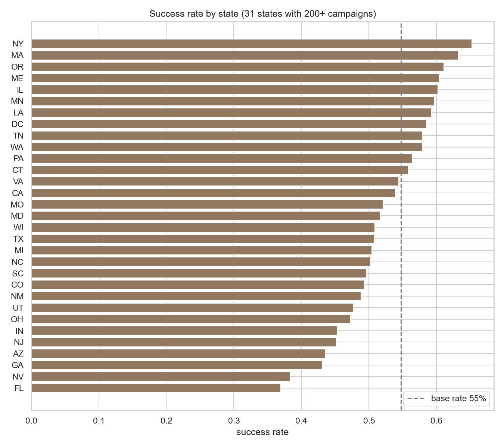

**Launch timing — year, month, weekday**
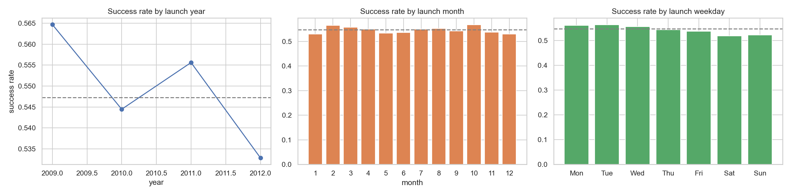

**Spearman correlation, launch-time features only**
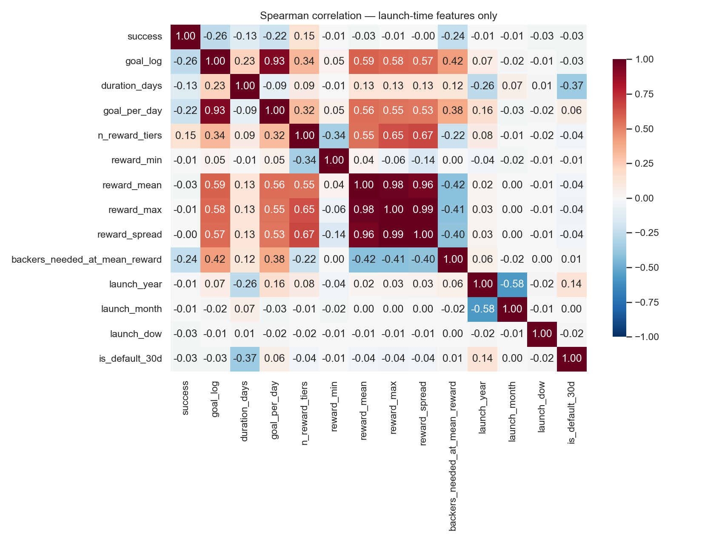

**Goal × duration interaction** (cells with 30+ campaigns)
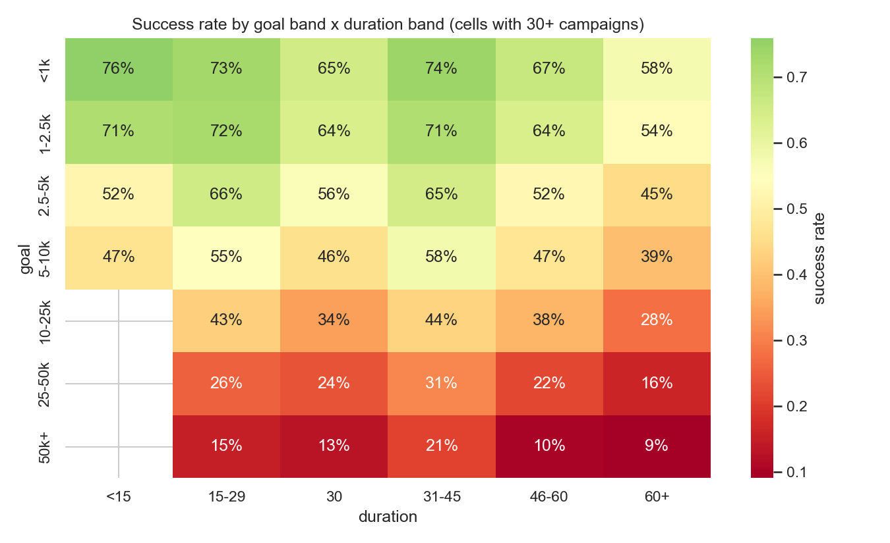

**Best and worst subcategories** (100+ campaigns, parent category in parentheses)
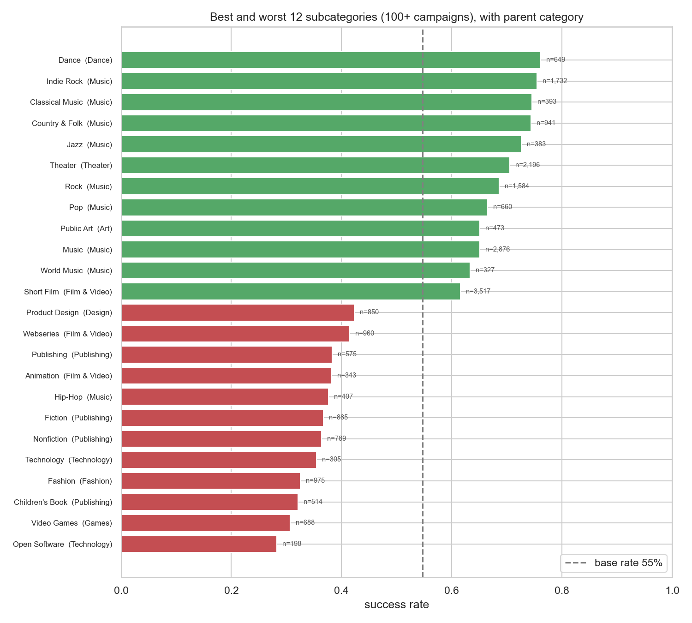

**Success rate by city** (150+ campaigns)
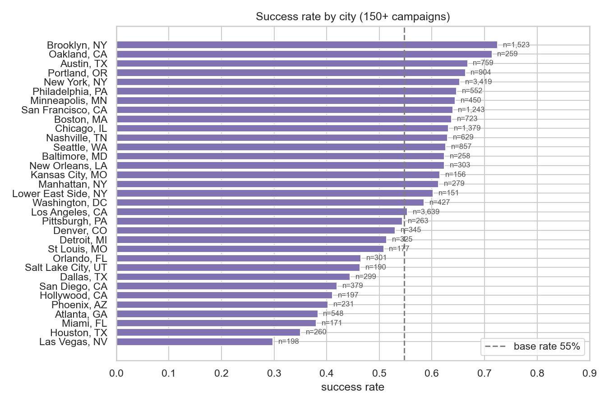

**Success rate by state — tile map**
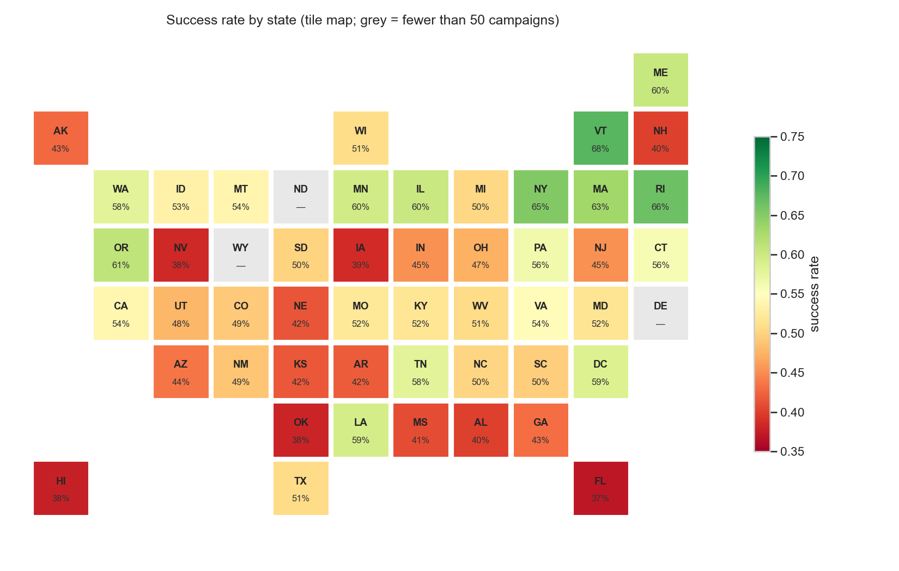

**Updates — post-launch, shown only to size the leak**
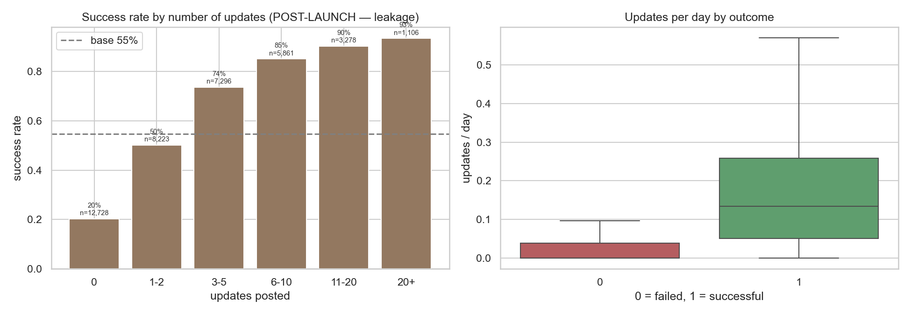

**Pairwise relationships among the leading launch-time features**
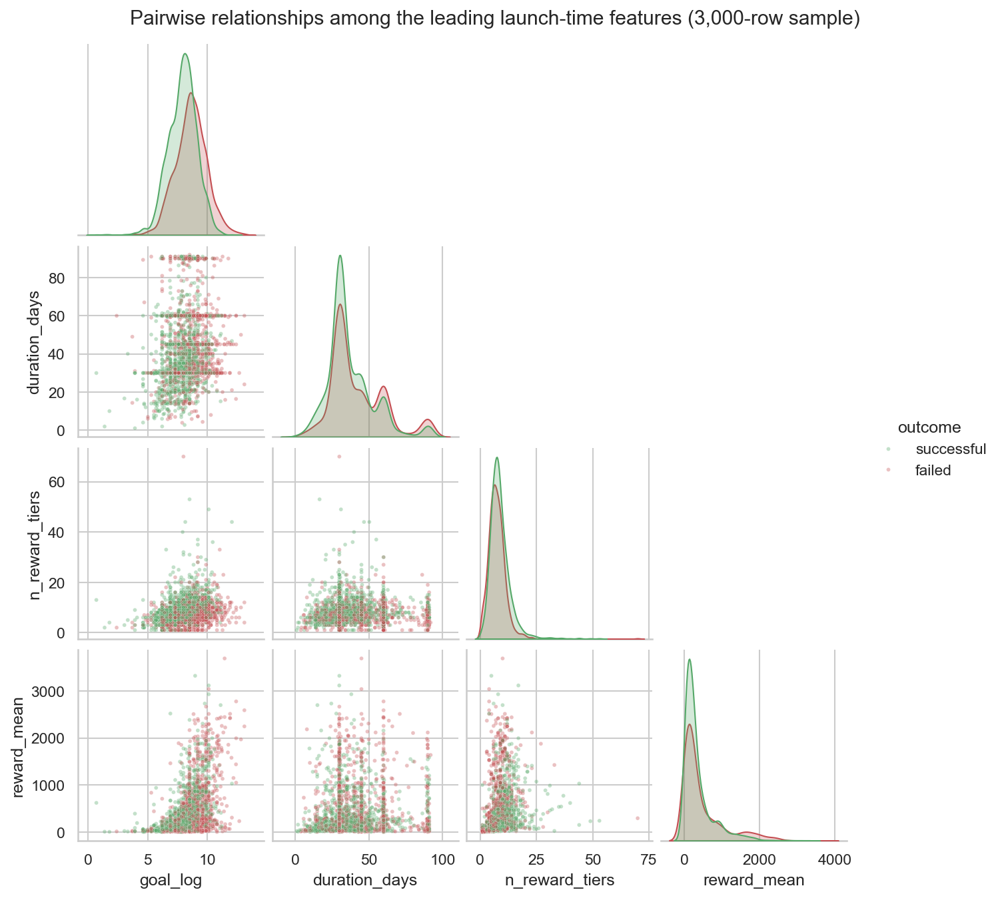

**Category × goal and category × duration interactions**
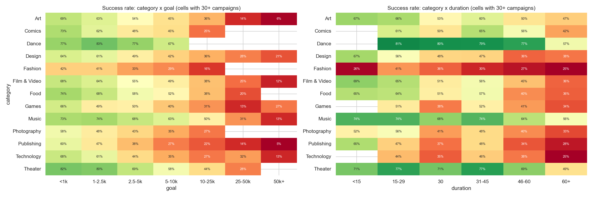

### Statistical confirmation and feature selection

With 38,492 rows every effect is significant at p < 0.01, so the ranking rests on effect sizes rather
than p-values.

| Test | Feature | Effect size | Verdict |
|---|---|---|---|
| Chi-square | `subcategory` / `category` / `state` | Cramér's V 0.261 / 0.221 / 0.157 | Keep all three |
| Chi-square | `region` (4 Census regions) | 0.101 | Lossy recoding of `state` — dropped |
| Chi-square | `launch_dow`, `is_default_30d`, `launch_month`, `launch_year` | 0.020–0.030 | Significant but trivial |
| Mann-Whitney | `goal_log` | rank-biserial −0.302 (medium) | Strongest numeric |
| Mann-Whitney | `backers_needed_at_mean_reward`, `goal_per_day`, `reward_min_to_goal`, `n_reward_tiers`, `duration_days` | −0.283 → +0.170 (small) | Keep |
| Mann-Whitney | `reward_mean/min/max/median/spread` | \|r\| ≤ 0.032 (negligible) | Drop or collapse |

The Welch t-test and Mann-Whitney disagree on the reward prices (`reward_max`: t = −14.4, p = 5e-47
vs. U-test p = 0.20); the t-test is reacting to the \$10,000 censoring in the tail, so the rank-based
result is the one trusted.

**Location.** Observed and category-mix-expected state rates correlate at 0.65, and controlling for
each state's category composition shrinks the spread only from 28.3 to 25.6 points — geography is not
just a category artifact. Residual leaders: NY +9.3, MA +7.6, OR +7.1; trailers: FL −16.3, NV −13.6,
GA −11.1. `state` is therefore kept (target-encoded), `region` is not used, and `city` (3,153 levels)
is dropped.

**Interactions.** Within-category ρ(`goal_log`, success) runs from −0.30 (Food, Publishing) to −0.13
(Dance), so the goal penalty is category-dependent — an argument for tree ensembles or explicit
Goal × Category terms over plain logistic regression.

**Collinearity (|ρ| ≥ 0.8).** `reward_max`/`reward_spread` 0.993, `reward_mean`/`reward_max` 0.979,
`reward_mean`/`reward_spread` 0.960, `goal_log`/`goal_per_day` 0.929,
`reward_mean`/`reward_median` 0.828.

**Recommended feature set for Milestone 3**
- *Keep (ranked):* `goal_log`, `backers_needed_at_mean_reward`, `goal_per_day`, `subcategory`,
  `category`, `n_reward_tiers`, `duration_days`, `state`.
- *Keep but expect little:* `reward_min_to_goal`, `is_default_30d`, `launch_month`, `launch_dow`,
  `launch_year`.
- *Drop:* `reward_mean`, `reward_median`, `reward_max`, `reward_spread` (negligible and mutually
  collinear), `region`, `city`, and every post-launch column.
- *Linear baseline only:* keep one of the three goal-derived features; tree models can take all three.
- *Class imbalance:* none worth correcting at 54.7% / 45.3% — no resampling or class weighting.

### Challenges
- **Data leakage:** `funded percentage` (ρ = 0.86), `backers` (0.72), `pledged` (0.70),
  `update_frequency` (0.57), `updates` (0.55) and `comments` (0.47) all beat every genuine
  launch-time feature. All six are excluded from the model matrix.
- **The 30-day artifact:** the exactly-30-day band (53.6%) underperforms the 31–45 day band (61.0%),
  breaking the otherwise-downward duration trend. 30 days is Kickstarter's default, so that band is
  dominated by creators who accepted it rather than chose it — a selection effect, handled with the
  `is_default_30d` flag.
- **Skewed and censored values:** goals reach $21.47M (= 2³¹ cents, an overflow sentinel rather than
  a real goal) and reward amounts cap at exactly $10,000 in the source scrape. Log transforms and
  rank-based correlation limit the damage; a hard upper clip is worth testing at the modeling stage.
- **Correlated features:** `goal_log`, `goal_per_day` and `backers_needed_at_mean_reward` share
  terms, as do the reward statistics. Tree models tolerate this; a linear baseline needs
  regularization.

---

## 🧠 Model Development *(Milestone 3, in progress)*

Plan:
- Stratified 80/20 train/test split — **already built**, in `data/processed/train_encoded.csv` and
  `test_encoded.csv`, with all encoders and scalers fitted on the training split only.
- Baseline: Logistic Regression; compare with KNN, Random Forest, and XGBoost.
- Headline models use **launch-time features only**. Separately, run a leakage *ablation* that adds
  `updates` back in — not as a candidate model, but to quantify how much the original ~80% benchmark
  owed to post-launch information.
- Replace the single split with cross-validation before reporting final numbers, so results do not
  hinge on one partition.
- Tune with `GridSearchCV`; explain with feature importance and SHAP.

---

## 📈 Results & Key Findings

| Model | Accuracy | Precision | Recall | F1 | ROC-AUC |
|-------|----------|-----------|--------|----|---------|
| Logistic Regression | | | | | |
| KNN | | | | | |
| Random Forest | | | | | |
| XGBoost | | | | | |

---

## 🚀 Next Steps

- Finish the modeling notebook and fill in the results table above.
- Build the recommendation prototype for at-risk campaigns — most of the actionable levers it will
  use (goal, duration, tier count) are the features the EDA already ranked.
- Test a hard upper clip on `goal` to handle the $21.47M overflow sentinel.
- Limitations to address:
  - **Association, not causation.** More reward tiers correlate with success, but most plausibly as
    a proxy for creator preparation. Recommendations must be framed accordingly.
  - **Single split.** Current numbers would rest on one partition; move to cross-validation.
  - **Era.** The data stops in mid-2012.

---

## 📝 License

To be confirmed with the Challenge Advisor.

---

## 📄 References

- [Kickstarter](https://www.kickstarter.com/)
- Kickstarter Projects dataset (Kaggle)
- [scikit-learn documentation](https://scikit-learn.org/stable/)
- [pandas documentation](https://pandas.pydata.org/docs/)
- [XGBoost documentation](https://xgboost.readthedocs.io/)
- [SHAP documentation](https://shap.readthedocs.io/)

---

## 🙏 Acknowledgements

Thank you to Challenge Advisor **Parth Rana** and AI Studio Coach **Darshan Ugale** for their guidance, and to Break Through Tech AI Studio.
